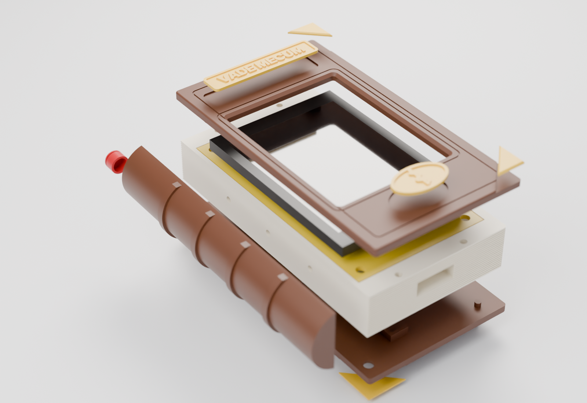

# VADE MECUM — CYD 2.8" için deri ciltli cep el kitabı

*Vade mecum* Latince "yanımda gel" demek; hekimlerin yüzyıllardır cepte taşıdığı başvuru kitaplarına
verilen ad. Bu kasa, ESP32-2432S028R'yi (CYD 2.8") eski bir kütüphaneden çıkmış gibi duran, deri ciltli
küçük bir kitaba dönüştürüyor. Tıp okuyan, old money tarzını seven biri için tasarlandı.

<p align="center">
  
  
</p>

| Kitap parçası | İşlevi |
|---|---|
| Ön kapak | Ekran, varak çerçeveli bir levha gibi kapakta duruyor. Üstte yaldız başlık levhası, altta Asklepios asalı arma, ön kenar köşelerinde pirinç köşelikler var |
| Sayfa bloğu | Kartı, pili ve şarj devresini taşıyor. Baş, kuyruk ve ön kenarda krem sayfa çizgileri; ön kenardaki bazı "sayfa aralıkları" havalandırma yarığı |
| Yuvarlak sırt | Kabartma bantları var, içinde kalem tüneli. Tepedeki kırmızı kapitalbant kalemin başlığı: çekince kalem çıkar |
| Kırmızı kurdele ayraç | Anahtarlık deliği |
| Arka kapak | Fotoğraf çerçevelerindeki gibi tek bir çapraz şövale ayağı |

## Duruş

Ayak, arka kapaktaki cebinden açılır ve 40°'de durur (durdurak modelde test edildi: 0–40° serbest, sonrası
kilitli). Kitap:

- **dikey** (sayfa gibi) kuyruğu üstünde **24°** yaslanarak,
- **yatay** (ön kenarı üstünde, sırt yukarıda) **18°** yaslanarak durur.

Ekran içeriğini yazılımda döndür (`tft.setRotation`).

## Parçalar ve renkler

Dosyalar `vademecum_cikti/` klasöründe, **baskı yönünde** (STL + 3MF). Montaj: `vademecum_montaj.step`.

| Dosya | Adet | Konyak | Yeşil | Siyah & Yaldız |
|---|---|---|---|---|
| `on_kapak`, `arka_kapak`, `sirt`, `sovale_ayagi` | 1'er | çikolata | koyu yeşil | siyah |
| `sayfa_blogu` | 1 | beyaz (krem) | beyaz | **sarı** (yaldızlı sayfa kenarı) |
| `baslik_levhasi`, `arma` | 1'er | sarı | sarı | sarı |
| `kose_on_x2` / `kose_arka_x3` | 2 / 3 | sarı | sarı | sarı |
| `kurdele`, `kapitalbant` | 1'er | kırmızı | kırmızı | kırmızı |

Baskı:

- PETG veya PLA, 0,4 nozul, 0,2 mm katman. Levha, arma, köşelik ve kapitalbant için 0,12 mm.
- 3 duvar, %15–20 dolgu, destek yok.
- **Kapakları dokulu PEI tablada bas.** Dış yüz tablaya geldiği için deri dokusu kendiliğinden oluşur.
- Sırt dik basılır (yuvarlak profil ve kalem tüneli kusursuz çıkar), sayfa bloğu arka yüzü tablada basılır.

Bütün parçalar text-to-cad FDM baskı kontrolünden geçti; hata yok, kalan uyarılar küçük köprüler ve boşluklar.
Bu kontroller genel tasarım kuralları; önce küçük parçalarla yazıcının toleransını dene.

## Donanım

- 3× M3×10 havşa başlı (arka kapak; başları pirinç köşeliklerin altında kalır)
- 4× M3×6 (kartı ön kapağın ayaklarına bağlar)
- ~14 mm 1,75 mm filament parçası (ayak menteşe pimi)
- LiPo 503450 (5×34×50 mm, ~1000 mAh, korumalı)
- TP4056 USB-C şarj modülü (~28×17 mm); USB-C girişi kitabın başında
- SS12D00 sürgülü anahtar (kitabın başında, sırta yakın)
- Önerilen: küçük bir 5 V yükseltici (~22×12 mm sınıfı). CYD'nin 5 V girişindeki 3,3 V regülatörü pil
  gerilimiyle (3,7–4,2 V) sınırda çalışır; pil boşaldıkça ekran kararır ya da kart yeniden başlar.
  Arka kapakta, TP4056'nın solunda ~25×33 mm boş yer var.

## Montaj

1. Başlık levhasını, armayı ve 2 ön köşeliği ön kapaktaki yuvalarına yapıştır.
2. Ön kapağı sayfa bloğunun önüne oturt (4 pim) ve yapıştır.
3. Kurdeleyi sayfa bloğunun içinden baştaki yarığa geçir; T ucu içeride kalır.
4. Sırtı sayfa bloğunun sol yüzüne oturt (3 pim) ve yapıştır.
5. CYD'yi ekranı ön kapağa bakacak şekilde 4 ayağa koy, 4× M3×6 ile vidala.
6. Arka kapakta:
   - ayağı cebine yerleştir, filament pimi menteşe bloğundan geçir;
   - pili tırnakların arasına bantla;
   - TP4056'yı raylara USB-C başa bakacak şekilde yerleştir.

   Anahtarı sayfa bloğunun baştaki cebine yerleştir. Kablolama: pil → TP4056 B+/B−, OUT+ → anahtar →
   yükselticinin girişi, yükselticinin 5 V çıkışı → CYD 5 V, eksiler → GND. Yükseltici yoksa OUT+ anahtardan
   doğrudan CYD 5 V'a gider.
7. Arka kapağı kapat (ön kenar-kuyruk köşesindeki pim yerine oturur). 3× M3×10 havşa başlıyı tak,
   3 arka köşeliği vidaların üstüne bastır.
8. Kapitalbandı kalemin arka ucuna bastır, kalemi sırtın tepesinden tünele it.

## Ölç ve düzelt (parametreler, `vademecum.py`'nin başında)

| Parametre | Varsayılan | Ne |
|---|---|---|
| `delik_araligi_kisa/uzun` | 42 × 78 mm | Kart montaj delikleri |
| `ekran_kaydirma` | 0 | LCD'nin kartın uzun ekseninde kayması |
| `usb_x` | 30 mm | Baştaki USB'nin sırttan uzaklığı |
| `sd_x` | 35 mm | Kuyruktaki microSD'nin sırttan uzaklığı |
| `kalem_cap` / `kalem_boy` | 5 / 87 mm | Kalemini ölç (tünel 98 mm'ye kadar alır) |
| `ayak_acisi` | 40° | Ayak durdurağı; büyütürsen kitap daha çok yaslanır |

Değiştirip `cad run vademecum.py` çalıştır, sonra çıktıları yeniden dışa aktar.

## Görseller

`render/vademecum/` klasöründe. Blender/Cycles ile `render3.py` çizdi; ekrandaki sayfa da render'ın parçası.

| Dosya | Ne gösteriyor |
|---|---|
| `on_konyak.png`, `on_yesil.png`, `on_siyah.png` | Üç renk seçeneği, dikey duruş |
| `yatay_konyak.png` | Yatay duruş, sırt yukarıda |
| `kalem_konyak.png` | Kalem sırttan çekilmiş; kırmızı kapitalbant kalemin başlığı |
| `arka_konyak.png`, `arka_siyah.png` | Arka kapak ve açık şövale ayağı |
| `patlatma_konyak.png` | Bütün parçalar ayrık |

<p align="center">
  
  
  
</p>
<p align="center">
  
  
</p>

Yeniden çizmek için (renkler `palet_*.json` dosyalarında):

```sh
cad run render3.py render/vademecum/dikey.glb on.png --gorunum on --ekran \
    --palet "$(cat render/vademecum/palet_konyak.json)" --genislik 1100 --yukseklik 1400 --diyafram 16
```

GLB'ler: `dikey`, `yatay`, `kalem`, `patlatma`. Bakış: `on`, `arka`, `yan`, `ust`, `patlatma`, `detay` ya da
`--gorunum=x,y,z` (eksi işaretli yönlerde `=` şart).
