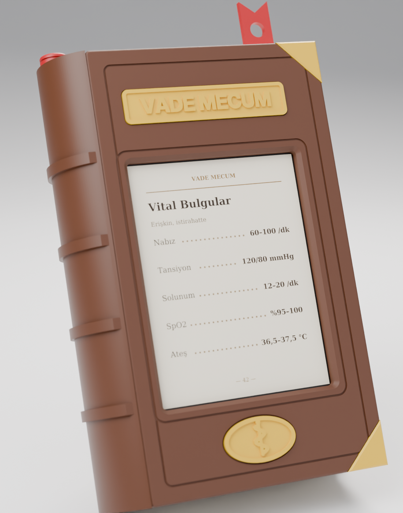
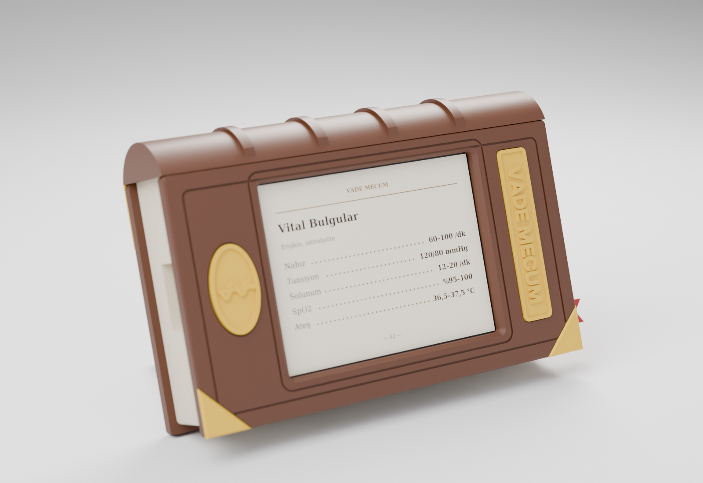
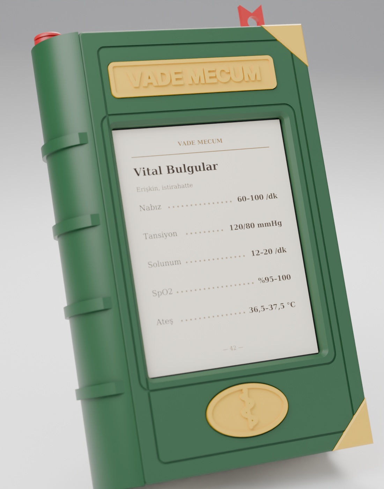
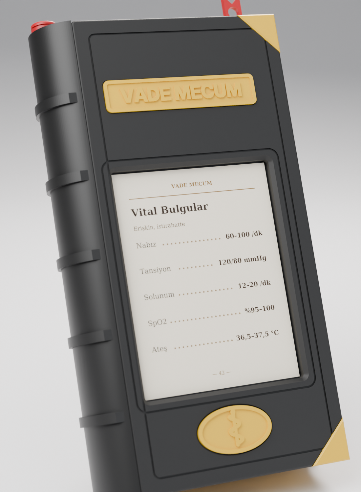
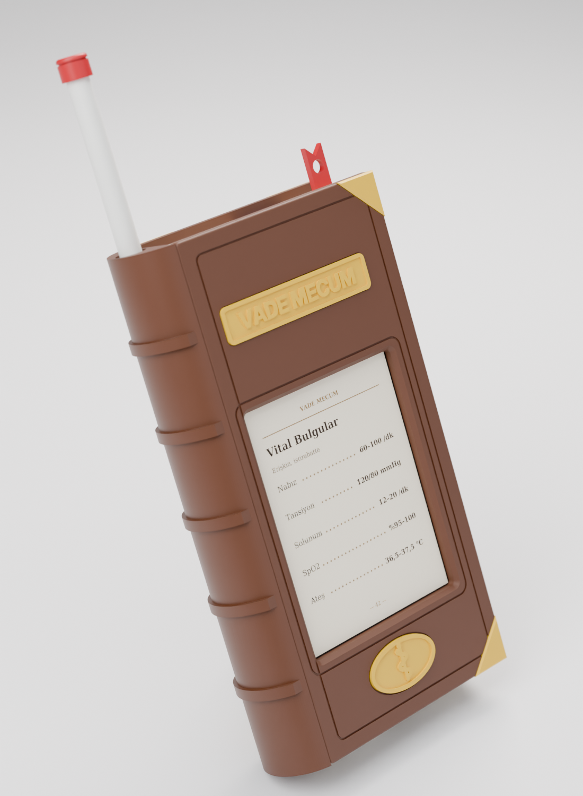
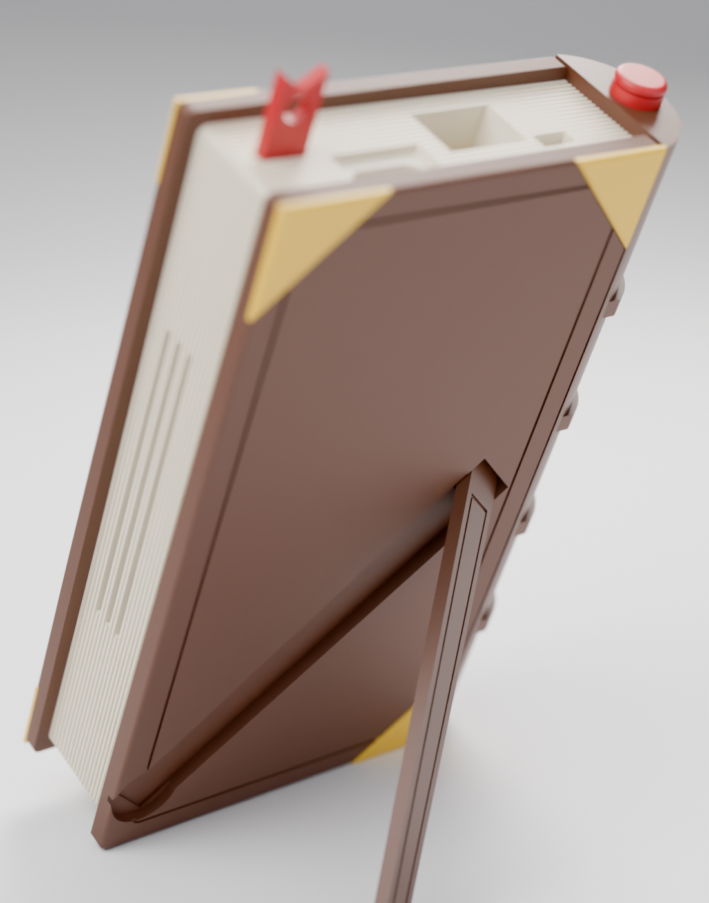

# VADE MECUM — CYD 2.8" için deri ciltli cep el kitabı

*Vade mecum* Latince "yanımda gel" demek; hekimlerin yüzyıllardır cepte taşıdığı başvuru kitaplarına
verilen ad. Bu kasa, ESP32-2432S028R'yi (CYD 2.8") eski bir kütüphaneden çıkmış gibi duran, deri ciltli
küçük bir kitaba dönüştürüyor. Tıp okuyan, old money tarzını seven biri için tasarlandı.
Ölçüler: **6,9 × 10,7 × 2,6 cm**. İlk tasarım 6,6 × 10,4 × 2,2 cm idi; ölçülen parçalar (8 mm'lik pil,
40×18 mm'lik MT3608) sığsın diye oran korunarak büyütüldü.

<p align="center">
  
  
</p>

| Kitap parçası | İşlevi |
|---|---|
| Ön kapak | Ekran, varak çerçeveli bir levha gibi kapakta duruyor. Üstte yaldız başlık levhası, altta Asklepios asalı arma, ön kenar köşelerinde pirinç köşelikler var |
| Sayfa bloğu | Kartı, pili ve şarj devresini taşıyor. Baş, kuyruk ve ön kenarda krem sayfa çizgileri; ön kenardaki bazı "sayfa aralıkları" havalandırma yarığı. Başta kartın USB-C'si, şarj girişi, anahtar ve kurdele |
| Yuvarlak sırt | Kabartma bantları var, içinde kalem tüneli. Tepedeki kırmızı kapitalbant kalemin başlığı: yuvasına tık diye oturur (tırnak), çekince kalem çıkar, baş aşağıda düşmez |
| Kırmızı kurdele ayraç | Anahtarlık deliği |
| Arka kapak | Fotoğraf çerçevelerindeki gibi tek bir çapraz şövale ayağı |

## Duruş

Ayak, arka kapaktaki cebinden açılır ve 40°'de durur (durdurak modelde test edildi: 0–40° serbest, sonrası
kilitli). Kitap:

- **dikey** (sayfa gibi) kuyruğu üstünde **24°** yaslanarak,
- **yatay** (ön kenarı üstünde, sırt yukarıda) **22°** yaslanarak durur.

Ekran içeriğini yazılımda döndür (`tft.setRotation`).

## Parçalar ve renkler

**Renk tablaları** (`vademecum_cikti/tablalar/`): her renk tek dosyada, parçalar baskı yönünde yan yana.
3MF'te her parça ayrı nesnedir; tabla 165 × 110 mm'ye sığar.

| Tabla dosyası | Renk (konyak) | İçindekiler |
|---|---|---|
| `tabla_1_cikolata` | çikolata | ön kapak, arka kapak, sırt (dik), şövale ayağı |
| `tabla_2_krem` | beyaz | sayfa bloğu (ön yüzü tablada) |
| `tabla_3_sari` | sarı | başlık levhası, arma, 2 ön + 3 arka köşelik |
| `tabla_4_kirmizi` | kırmızı | kurdele, kalem başlığı (kapitalbant) |

Tek tek dosyalar da aynı klasörde:

Dosyalar `vademecum_cikti/` klasöründe, **baskı yönünde** (STL + 3MF). Montaj: `vademecum_montaj.step`.

| Dosya | Adet | Konyak | Yeşil | Siyah & Yaldız |
|---|---|---|---|---|
| `on_kapak`, `arka_kapak`, `sirt`, `sovale_ayagi` | 1'er | çikolata | koyu yeşil | siyah |
| `sayfa_blogu` | 1 | beyaz (krem) | beyaz | **sarı** (yaldızlı sayfa kenarı) |
| `baslik_levhasi`, `arma` | 1'er | sarı | sarı | sarı |
| `kose_on_x2` / `kose_arka_x3` | 2 / 3 | sarı | sarı | sarı |
| `kurdele`, `kapitalbant` | 1'er | kırmızı | kırmızı | kırmızı |

Baskı:

- PETG veya PLA, 0,4 nozul, 0,2 mm katman. Levha, arma, köşelik ve kapitalbant için 0,12 mm.
- 3 duvar, %15–20 dolgu, destek yok.
- **Kapakları dokulu PEI tablada bas.** Dış yüz tablaya geldiği için deri dokusu kendiliğinden oluşur.
- Sırt dik basılır (yuvarlak profil ve kalem tüneli kusursuz çıkar).
- Sayfa bloğu **ön yüzü tablada** basılır (STL zaten öyle): kartın altındaki geniş boşluk böylece desteksiz çıkar.

Bütün parçalar text-to-cad FDM baskı kontrolünden geçti; hata yok, kalan uyarılar küçük köprüler ve boşluklar.
Bu kontroller genel tasarım kuralları; önce küçük parçalarla yazıcının toleransını dene.

## Donanım

- Vida yok. Kart, ön kapağın pimlerine ısıl perçinle tutturulur; arka kapak 4 esnek tırnakla oturur
- Yapıştırıcı (süsler, ön kapak, sırt, kalem başlığı, arka köşelikler) ve çift taraflı bant (pil, TP4056, MT3608)
- LiPo 51×36×8 mm
- TP4056 USB-C şarj modülü, korumalı (HW-373, 31×19×5 mm)
- MT3608 yükseltici (40×18×6 mm)
- Sürgülü anahtar (gövde 11,5×6 mm)
- Kart: ESP32-2432S028R (CYD 2.8"), toplam kalınlık 11 mm

## İç düzen ve kablolama

İç düzen `render/vademecum/ic_konyak.png`'de (ön kapak ve kart kaldırılmış).

| Parça | Yeri |
|---|---|
| Pil | Kuyrukta enine; kablolu ucu sırt tarafında, önünde 4 mm kablo payı |
| MT3608 | Ortada boyuna; VOUT kuyruk tarafında, VIN baş tarafında |
| TP4056 | Başta sırt tarafında, USB-C'si baştaki şarj deliğine oturur |
| Anahtar | Başın ortasında, kolu baş kenardan çıkar; arka kapaktaki beşikte durur |

Kablolama (fotoğraftaki devre; çizim: `render/vademecum/kablolama.png`):

1. Pil → TP4056 B+/B−
2. TP4056 OUT+ → anahtar → MT3608 VIN+
3. TP4056 OUT− → MT3608 VIN−
4. MT3608 VOUT+/VOUT− → kartın **P1 konnektörü (VIN/GND)**

MT3608 çıkışını karta bağlamadan önce trimpotla 5,0 V'a ayarla. Kartın USB-C girişi boş kalır, baştaki
delikten PC kablosu takılır. **Kod yüklemeden önce anahtarı kapat.** Şarjı da tercihen anahtar kapalıyken yap.

Kablolar modelde Ø1,6 mm tüp olarak çizildi. Hiçbir duvara, karta ya da parçaya değmiyorlar. Birbirlerini
yalnızca serbest boşlukta kesiyorlar, oralarda üst üste geçebilecek kadar yer var. 24–26 AWG silikon kablo
kullan.

## Montaj

1. Başlık levhasını, armayı ve 2 ön köşeliği ön kapaktaki yuvalarına yapıştır.
2. Ön kapağı sayfa bloğunun önüne oturt (4 pim) ve yapıştır.
3. Kurdeleyi sayfa bloğunun içinden baştaki yarığa geçir; T ucu içeride kalır.
4. Sırtı sayfa bloğunun sol yüzüne oturt (3 pim) ve yapıştır.
5. CYD'yi ekranı ön kapağa bakacak şekilde, kartın 4 deliği ön kapağın 4 pimine geçecek şekilde oturt. Pimlerin
   kartın arkasından çıkan 1,6 mm'lik uçlarını sıcak havya ucuyla 2–3 saniye bastırıp yassılat (ısıl perçin).
   Havyayı kartın bakır yollarına değdirme.
6. Arka kapakta:
   - ayağı cebine bastır: C şeklindeki menteşesi arka kapağın pimine tık diye takılır. Ayak kapalıda ve 40°'de
     tık diye oturur, arada hafif dirençle döner;
   - pili tırnakların arasına bantla;
   - TP4056'yı yatağına, USB-C başa bakacak şekilde yerleştir;
   - MT3608'i yan tırnaklarının arasına bantla;
   - anahtarı beşiğine, kolu baştaki yarıktan çıkacak şekilde yerleştir.
   Kabloları yukarıdaki sırayla lehimle, P1 kablosunu karta tak.
7. Arka kapağı kapat: tırnaklar tık diye oturur. 3 arka köşeliği yapıştır. Açmak için arka kapağı kitabın
   kenarındaki 2 mm'lik paydan tırnakla kaldır; tırnaklar esneyip bırakır.
8. Kapitalbandı kalemin arka ucuna yapıştır, kalemi sırtın tepesinden tünele it; başlık tık diye oturur.

## Ölç ve düzelt (parametreler, `vademecum.py`'nin başında)

| Parametre | Varsayılan | Ne |
|---|---|---|
| `delik_araligi_kisa/uzun` | 42 × 78 mm | Kart montaj delikleri |
| `ekran_kaydirma` | −3,3 mm | Görüntü alanının kart ortasına göre kayması (ölçüldü: USB kenarına 18 mm); pencere buna göre |
| `cam_kaydirma` | −1,7 mm | Camın (70×50) kart ortasına göre kayması; kart ayakları cama göre düz kesilir |
| `usb_x` | 35,6 mm | Kartın USB-C'sinin kitabın sırt kenarına uzaklığı (baş delik buna göre) |
| `kalem_cap` / `kalem_boy` | 5 / 87 mm | Kalemini ölç (tünel 98 mm'ye kadar alır) |
| `ayak_acisi` | 40° | Ayak durdurağı; büyütürsen kitap daha çok yaslanır |

Değiştirip `cad run vademecum.py` çalıştır, sonra çıktıları yeniden dışa aktar.

## Görseller

`render/vademecum/` klasöründe. Blender/Cycles ile `render3.py` çizdi; ekrandaki sayfa da render'ın parçası.

| Dosya | Ne gösteriyor |
|---|---|
| `on_konyak.png`, `on_yesil.png`, `on_siyah.png` | Üç renk seçeneği, dikey duruş |
| `yatay_konyak.png` | Yatay duruş, sırt yukarıda |
| `kalem_konyak.png` | Kalem sırttan çekilmiş; kırmızı kapitalbant kalemin başlığı |
| `arka_konyak.png`, `arka_siyah.png` | Arka kapak ve açık şövale ayağı |
| `patlatma_konyak.png` | Bütün parçalar ayrık |
| `ic_konyak.png` | İç düzen ve kablolar (üstten, ön kapak ve kart kaldırılmış) |
| `bas_konyak.png`, `kenar_konyak.png` | Baş kenardaki delikler; ön kenar |
| `ic_konyak.png` | İç düzen (üstten, ön kapak ve kart yok): pil, MT3608, TP4056, anahtar |

<p align="center">
  
  
  
</p>
<p align="center">
  
  
</p>

Yeniden çizmek için (renkler `palet_*.json` dosyalarında):

```sh
cad run render3.py render/vademecum/dikey.glb on.png --gorunum on --ekran \
    --palet "$(cat render/vademecum/palet_konyak.json)" --genislik 1100 --yukseklik 1400 --diyafram 16
```

**Montaj videosu:** `montaj.mp4` (35 sn): kitap parçalarına ayrılır, her parça altyazıyla yerine girer.
Kareleri `render4.py` çizer (`montaj.glb` üzerinden), altyazıyı ve MP4'ü `montaj_video.py` yapar.
Video ilk 6,6 × 10,4 cm'lik sürümü gösteriyor; iç düzen ve ölçüler artık farklı.

GLB'ler: `dikey`, `yatay`, `kalem`, `patlatma`. Bakış: `on`, `arka`, `yan`, `ust`, `patlatma`, `detay` ya da
`--gorunum=x,y,z` (eksi işaretli yönlerde `=` şart).
